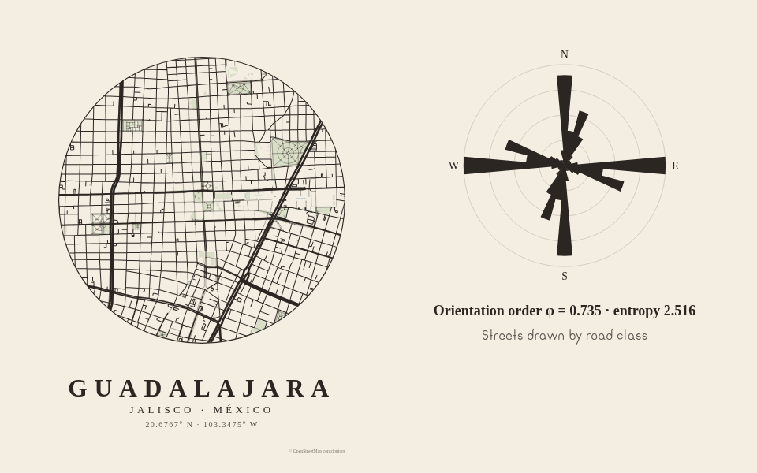

# <picture><source media="(prefers-color-scheme: dark)" srcset=".github/assets/icon-dark.svg"></picture> traza

[](https://www.npmjs.com/package/traza)
[](https://bundlejs.com/?q=traza)
[](LICENSE)

Headless street infographics: city posters, orientation roses, network stats and street-name maps.



**[Live demo](https://ghegar.github.io/traza/)**

traza takes a street network — from OpenStreetMap or from your own GeoJSON/WFS layer — and gives you
the data for four pieces: a city poster, a street orientation rose, network statistics and
street-name maps. It owns the network model, the local projection, the poster scene and the numbers;
you own every pixel. It ships no palette, font or theme: the optional SVG serializer only draws with
the theme you pass.

## Install

```bash
npm install traza
```

| Entry | What it is | Needs |
|---|---|---|
| `traza` | Street network model, geodesic helpers, local projection | nothing |
| `traza/osm` | Overpass query, fetch with area cap and `AbortSignal`, parser to network, water, parks and buildings | `fetch` |
| `traza/sources` | GeoJSON and paged WFS (`CRS:84`) to network, joining vertices within a tolerance | `fetch` |
| `traza/orientation` | Length-weighted bearing histogram, entropy and orientation order φ | nothing |
| `traza/stats` | Length by class, intersections, dead ends, degree, circuity, street and intersection density | nothing |
| `traza/names` | Street-name parsing (Mexican street types and abbreviations), categories from your rules, rankings | nothing |
| `traza/poster` | Poster scene: projected layers, circle or rectangle frame, title block, attribution | nothing |
| `traza/svg` | Poster and rose to SVG with your theme | nothing |
| `traza/ol` | OpenLayers features and layer with `roadClass`, `classIndex`, `bearing` and `category` | `ol >= 10` |

## Quick start

```ts
import { bboxAround } from 'traza';
import { loadOsm } from 'traza/osm';
import { orientation } from 'traza/orientation';
import { createPosterScene } from 'traza/poster';
import { posterToSvg, roseToSvg } from 'traza/svg';

const center: [number, number] = [-103.3475, 20.6767];
const { network, extras } = await loadOsm({ bbox: bboxAround(center, 1000) }, { water: true, parks: true });

const scene = createPosterScene({ network, extras, center, radius: 1000, title: 'Guadalajara' });
const poster = posterToSvg(scene, { background: '#f3ede2', defaultLayer: { stroke: '#2b2622' }, layers: {}, text: {} });
const rose = roseToSvg(orientation(network), { fill: '#2b2622' });
```

## Your own data

Any line layer works as long as each feature carries a name and something you can map to a road class.

1. Serve the layer as GeoJSON, or as WFS that can answer in `CRS:84` (lon/lat).
2. Map your attributes: `name` is a property name or a function; `roadClass` returns one of
   `motorway`, `primary`, `secondary`, `tertiary`, `residential` or `path`.
3. Pick a `tolerance` in meters: a layer without topology does not share vertices, so endpoints closer
   than that are joined into one node.

```ts
import { loadWfsNetwork } from 'traza/sources';

const network = await loadWfsNetwork({
    url: 'https://example.org/geoserver/wfs',
    typeName: 'ws:streets',
    bbox: [-103.36, 20.66, -103.33, 20.69],
    name: (properties) => `${properties.TIPOVIAL} ${properties.NOMVIAL}`,
    roadClass: (properties) => properties.TIPOVIAL === 'Avenida' ? 'primary' : 'residential',
    tolerance: 1,
});
```

`fromGeoJSON` does the same for a collection you already have (`LineString` and `MultiLineString`),
and `areasFromGeoJSON` turns your polygons into water, park or building areas for the poster.

| Question | OpenStreetMap | Your own data |
|---|---|---|
| Loader | `loadOsm` | `loadWfsNetwork`, `fromGeoJSON` |
| Road class | From `highway` | Your `roadClass` mapping |
| Topology | Shared OSM nodes | Joined by `tolerance` |
| Water, parks, buildings | Optional layers of the query | `areasFromGeoJSON` |
| Attribution | Always drawn | Only yours, if you pass it |

## Poster and themes

`createPosterScene` returns data, not markup: projected layers in sheet units, the frame, the texts
and the attribution. Draw it yourself or pass it to `posterToSvg` with a theme.

```ts
const scene = createPosterScene({ network, extras, center, radius: 1000, title: 'Guadalajara', subtitle: 'Centro' });
const svg = posterToSvg(scene, {
    background: '#f3ede2',
    layers: {
        primary: { stroke: '#2b2622', width: 1.8 },
        residential: { stroke: '#2b2622', width: 0.7 },
        park: { fill: '#d5dcc3' },
        water: { fill: '#b9cfd8' },
    },
    text: { title: { fill: '#2b2622', fontSize: 22, letterSpacing: 6, uppercase: true } },
});
```

| Option | Default | What it does |
|---|---|---|
| `center`, `radius` | Middle and half-size of the network | The area shown, in lon/lat and meters |
| `shape` | `circle` | `circle` or `rect` frame |
| `width`, `height` | `300`, `400` | Sheet size in scene units |
| `margin`, `textHeight` | 8 % of width, 16 % of height | Space around the frame and for the title block |
| `edgeKey` | The road class | Layer id of each street, e.g. its name category |
| `layerOrder` | water, park, building, waterway, then roads from `path` to `motorway` | Drawing order of layer ids |
| `title`, `subtitle`, `coordinates` | none, none, formatted center | Title block; `coordinates: false` hides them |
| `attribution` | none | Appended to the OSM attribution, never a replacement |

Title, subtitle and coordinates carry a `maxWidth` (the width inside the margins). `posterToSvg`
estimates their width from `fontSize`, `letterSpacing` and `advance` (average glyph width in em:
`0.75` for all-caps text, `0.6` otherwise) and, when it would overflow, sets `textLength` with
`lengthAdjust="spacingAndGlyphs"` so the text fits with any font. Raise `advance` for a wide font.

Layer ids are the road classes, `water`, `waterway`, `park`, `building` and whatever `edgeKey`
returns. A layer without a style in `layers` uses `defaultLayer`, or is not drawn.

## Orientation

Each segment counts in its bearing and the opposite one, weighted by length, in 36 bins centered on
north. Entropy is Shannon's `Hₒ`; order is `φ = 1 − ((Hₒ − H_g) / (H_max − H_g))²`, with `H_g = ln 4`
(a perfect grid) and `H_max = ln 36`. A perfect grid gives `φ = 1`; evenly spread streets give `φ ≈ 0`.
The method follows Boeing (2019), *Urban spatial order: street network orientation, configuration,
and entropy*.

`orientation(network, { bins, weight, classes })` takes `weight: 'count'` to count segments instead of
meters and `classes` to leave out paths. `roseToSvg(result, theme, { size, scale, labels })` draws
it; `scale: 'area'` (the default) makes petal area proportional to the share.

## Statistics

```ts
import { networkStats } from 'traza/stats';
import { streetTypes, topStreetNames } from 'traza/names';

const { totalLength, intersections, deadEnds, circuity, lengthDensityKmPerKm2 } = networkStats(network, { area: Math.PI * 1000 ** 2 });
const top = topStreetNames(network, { limit: 10, classes: ['primary', 'secondary', 'tertiary', 'residential'] });
const types = streetTypes(network);
```

Lengths are in meters and `area` in m² (`areaKm2` in km²). `lengthDensityKmPerKm2` is street length
per area, in km/km², and `intersectionsPerKm2` is intersections per km². `density` and
`intersectionDensity` are the same two values under their original names, kept for compatibility.
Intersections are nodes of degree 3 or more and dead ends nodes of degree 1. Circuity is network
length over straight-line distance between edge ends. Without `area` the network bounding box is used. Rankings group by normalized name, not by OSM way.

## Street names

```ts
import { categorizeNetwork } from 'traza/names';

const { byEdge, categories } = categorizeNetwork(network, [
    { id: 'women', match: ['Leona Vicario', 'Josefa Ortiz de Domínguez'] },
    { id: 'saints', match: /^(san|santa|santo) / },
    { id: 'dates', match: (name) => /^\d{1,2} de /.test(name.key) },
]);

const scene = createPosterScene({ network, edgeKey: (edge) => byEdge.get(edge.id) ?? 'other' });
```

Lists match whole words of the normalized name (`Av. Gral. Ramón Corona` → `general ramon corona`);
regular expressions run against the normalized key and the raw name; functions receive the parsed
name. The first rule that matches wins. Street types and abbreviations default to Mexican usage;
pass `types` and `abbreviations` for another country.

## OpenStreetMap

Data from OpenStreetMap is © OpenStreetMap contributors under the ODbL. When a network comes from OSM
the poster scene always carries that attribution and `posterToSvg` always draws it; your own
`attribution` is appended, never a replacement.

Be gentle with Overpass: `loadOsm` refuses areas above `maxArea` (25 km² by default) and never retries.
In Node, pass a descriptive `userAgent`: the main instance answers 406 to generic ones. `endpoint`
points to a mirror and `signal` cancels the request.

## OpenLayers

```ts
import { createStreetLayer } from 'traza/ol';

const layer = createStreetLayer(network, { categorize: (name) => name?.startsWith('San ') ? 'saints' : null });
```

Each feature carries `edgeId`, `roadClass`, `classIndex`, `name`, `length`, `bearing` and `category`,
ready for a style function. `networkToFeatures` gives the features without a layer. OSM networks add
the attribution to the source.

## Known limitations

- Overpass often answers 504, mirrors too. traza does not retry: call again or switch `endpoint`.
- A two-way street mapped as two separate ways is counted twice, in lengths and in the rose, as in
  OSMnx. Cycleways mapped as separate ways carry the street name: use `classes` to leave out `path`.
- The local azimuthal equidistant projection is meant for a city area, not for regions.
- Output is SVG only; rasterize it yourself for PNG or PDF.

## Development

```bash
npm test
npm run lint
npm run typecheck
npm run demo
```

The demo loads six city centers from Overpass and shows the poster with three themes, circle or
rectangle frame, colored by road class or by name category, the orientation rose with φ, the network
statistics and the most frequent names, with SVG and PNG export.

## Contributing

Issues are welcome. Open one before sending a pull request.

## License

AGPL-3.0-only © GHEgar
